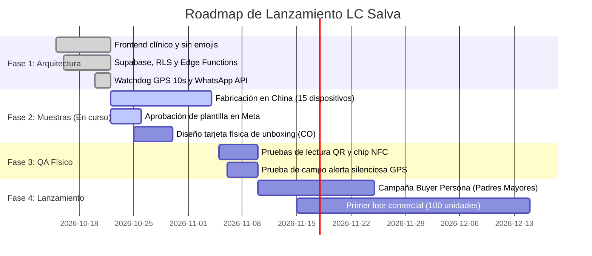

# 🛡️ LC Salva — Product Roadmap, Technical Architecture & Business Blueprint

> **Propósito de este documento:**  
> Servir como la **fuente única de verdad (Single Source of Truth)** técnica, funcional y comercial del proyecto **LC Salva**. Cualquier inteligencia artificial (Claude, ChatGPT, Gemini, Copilot) o desarrollador que consulte este repositorio debe comprender con máxima precisión qué es el producto, cómo opera su arquitectura de extremo a extremo, cuáles son sus precios oficiales y en qué fase se encuentra.

---

## 1. Visión y Definición del Producto

* **Nombre Oficial:** **LC Salva** (Desarrollado y respaldado por **LC Tech**).
* **Definición:** Ecosistema integral de salvaguarda y auxilio médico que combina **hardware pasivo no dependiente de baterías** (pulseras y placas con código QR de alta densidad y chip NFC NTAG) con una **ficha médica interactiva de emergencia en la nube**, un **panel PWA de gestión familiar** y un **sistema automatizado de telemetría y alerta silenciosa vía WhatsApp Cloud API**.
* **Propuesta de Valor Principal:** Acceso instantáneo a datos clínicos vitales (tipo de sangre, alergias, enfermedades, medicamentos, contactos SOS) en menos de 3 segundos ante una emergencia médica o desorientación, disparando una notificación satelital automática con ubicación GPS a los familiares del portador.
* **Regla Ética Inquebrantable:** **Los datos médicos de rescate vital NUNCA se bloquean ni se ocultan tras un muro de pago**. La ficha médica pública de emergencia es de acceso **100% gratuito de por vida** para cualquier usuario que adquiera hardware Salva.

---

## 2. Hardware Físico y Especificaciones de Fabricación

LC Salva opera con dos líneas de hardware pasivo fabricadas bajo estándares de alta durabilidad:

### A. Salva Band (Pulsera Inteligente de Emergencia)
* **Descripción:** Pulsera anatómica de silicona hipoalergénica con pastilla central integrada, diseñada para uso 24/7 (resistente al agua, sudor y baño).
* **Dimensiones:** Largo 244 mm × Ancho 16.6 mm. Cierre ajustable tipo reloj / pin metálico.
* **Tecnología de Lectura Doble:**
  1. **Grabado Láser QR:** Grabado de alta precisión en pastilla central con código serial visible inferior.
  2. **Chip NFC Pasivo NTAG (13.56 MHz):** Encapsulado impermeable bajo la pastilla de silicona.
  3. **Programación NFC:** Registro estándar **NDEF URI** con la misma URL del código QR (`https://lc-salva.pages.dev/ficha?qr=SALVA-B-xxxx`).
* **Proveedor de Muestras:** Allen Zhang (*Shenzhen Zd*). 10 unidades iniciales (`SALVA-B-T001` a `T010`) + lote adicional de 15 unidades (`SALVA-B-T011` a `T025`).

### B. Salva Watch (Pasador de Acero para Smartwatch y Relojes)
* **Descripción:** Pasador deslizante de perfil ultra-delgado en **Acero Inoxidable Quirúrgico AISI 316L**, diseñado para montarse sobre las correas de relojes inteligentes (Apple Watch, Garmin, Galaxy Watch, Amazfit) o tradicionales.
* **Compatibilidad:** Correas de 20 mm y 22 mm.
* **Tecnología de Grabado:** Láser de fibra óptica MOPA / Galvo con recocido térmico (*Black Annealing* permanente, profundidad ~0.03 mm sin aristas filosas).
* **Composición de la Placa:** Logotipo Salva + Código QR matricial (mínimo 12 × 12 mm con Quiet Zone ≥ 1.5 mm) + Código serial inferior visible.
* **Proveedor de Muestras:** Weifang Tengyi. 5 unidades iniciales (`SALVA-W-T001` a `T005`).

---

## 3. Modelo de Negocio y Precios Oficiales (Colombia - COP)

### A. Hardware (Pago Único con Ficha Digital Vital de por Vida)
Cada dispositivo incluye la pulsera o placa física más el perfil médico digital básico permanente:

| Producto | PVP Oficial (COP) | Margen Estimado | Qué incluye |
| :--- | :---: | :---: | :--- |
| **Salva Watch** *(Placa Acero 316L)* | **$45.000 COP** | ~75% bruto | Pasador de acero inoxidable grabado a láser + Ficha médica digital de por vida. |
| **Salva Band** *(Pulsera Silicona QR + NFC)* | **$59.000 COP** | ~60% bruto | Pulsera impermeable de silicona + Doble chip QR/NFC + Ficha médica digital de por vida. |
| **Pack Dúo Salva** *(1 Band + 1 Watch)* | **$89.000 COP** | ~65% bruto | Protección integral para casa/deporte + Fichas individuales independientes. |

### B. Membresía Anual: Salva Cloud & Respuesta Familiar
Servicio de valor agregado premium para familias que desean protección activa y automatizada:

* **Precio Estándar:** **$79.000 COP / año** (facturación anual).
* **Oferta Especial de Checkout (Order Bump):** **+$49.000 COP / año** al momento de adquirir cualquier hardware (descuento exclusivo de bienvenida).
* **Beneficios de Salva Cloud:**
  1. **Alertas Silenciosas por WhatsApp:** Notificación inmediata con ubicación GPS satelital enviada por la API oficial de Meta WhatsApp ante cada escaneo.
  2. **Red Multi-Tutor:** Notificación simultánea a hasta 5 familiares o tutores de emergencia.
  3. **Bóveda Médica Segura:** Almacenamiento cifrado de órdenes médicas, exámenes clínicos, PDFs y fórmulas en la nube.
  4. **Telemetría y Registro Histórico:** Trazabilidad completa de escaneos, fecha, hora, navegador y coordenadas de rescate.

> ⚠️ **Decisión de Arquitectura Financiera:**  
> **Se eliminó deliberadamente la suscripción mensual de $9.900 COP**. En Colombia, el 75%+ de las transacciones online se realizan vía Nequi y PSE. La pasarela Wompi no admite cobros automáticos recurrentes (tokenización periódica) con estos métodos. Forzar un cobro mensual manual provocaría una deserción (*churn*) superior al 80% en el segundo mes. El modelo de **Hardware de margen positivo + Anualidad Salva Cloud** elimina la fricción bancaria y garantiza flujo de caja inmediato.

---

## 4. Arquitectura de Software y Stack Tecnológico

El proyecto está diseñado bajo una filosofía de **cero dependencias complejas de frontend**, garantizando carga ultra-rápida en redes móviles precarias (3G/4G):

* **Frontend:** Vanilla HTML5 semántico, CSS3 puro (estilo *Swiss Clinical / Apple Health* sobrio, sin emojis, adaptado para móviles de 360 a 430 px y escritorio), Vanilla JavaScript ES6 modular.
* **PWA (Progressive Web App):** Instalable en Android e iOS mediante Service Worker (`sw.js`) y `manifest.webmanifest`.
* **Hosting / Edge CDN:** **Cloudflare Pages** con despliegue continuo desde la rama `main` en GitHub (`https://lc-salva.pages.dev`).
* **Backend y Base de Datos:** **Supabase** (PostgreSQL 15 administrado en AWS us-east-1).
  * Autenticación con Supabase Auth (Email / Magic Link).
  * Seguridad estricta con **Row Level Security (RLS)** y funciones `SECURITY DEFINER`.
  * Protección de datos bajo la Ley 1581 de Hábeas Data: la ficha pública solo expone datos a través del RPC `public.obtener_ficha_publica(codigo_qr)`, impidiendo la extracción masiva de portadores.
* **Edge Functions (Deno Runtime en Supabase):**
  * `alerta-escaneo`: Despacha plantillas de WhatsApp Cloud API a través de la infraestructura oficial de Meta.
  * `wompi-firma`: Genera firmas de integridad criptográfica SHA-256 para el widget de pago de Wompi.
* **Mensajería Automatizada:** **Meta WhatsApp Cloud API** (Graph API v19.0+), plantilla de categoría *Utility* (`alerta_escaneo_salva`). Costo marginal: ~$0.0008 USD (~$3-$4 COP) por notificación.
* **Pasarela de Pago:** **Wompi Colombia** (Bancolombia, Nequi, Tarjetas de Crédito/Débito, PSE).

---

## 5. Flujos de Operación del Sistema

### Flujo 1: Activación y Registro de Hardware Nuevo
1. El usuario compra una pulsera Salva y recibe el empaque físico.
2. Abre la cámara del celular y escanea el QR (o toca con NFC).
3. La URL `https://lc-salva.pages.dev/ficha?qr=SALVA-B-xxxx` se abre en el navegador.
4. El sistema detecta que el hardware está en estado `disponible` (no vinculado) y muestra la vista amigable con botón *"Vincular a mi Cuenta"*.
5. En [admin.html](admin.html), el usuario introduce el código, el servidor valida su autenticidad mediante `public.verificar_codigo_pulsera(codigo)` y se registra el portador en 60 segundos.

### Flujo 2: Escaneo de Auxilio en Vía Pública
1. Un transeúnte, socorrista o paramédico escanea la pulsera con su teléfono.
2. [ficha.js](ficha.js) inicia un **reloj guardián (Watchdog) de 10 segundos** para la geolocalización del navegador.
   * Si el usuario concede permiso GPS, se capturan coordenadas exactas.
   * Si el usuario ignora o rechaza la solicitud, a los 10 segundos el escaneo se procesa sin GPS, **garantizando que la alerta jamás quede bloqueada**.
3. Se invoca `public.registrar_escaneo()`, insertando en `public.escaneos_ubicacion`.
4. El Database Webhook de Supabase se activa y dispara la Edge Function `alerta-escaneo`.
5. Meta WhatsApp envía el mensaje de auxilio con enlace a Google Maps al acudiente principal (y a los tutores de la red Salva Cloud).
6. En pantalla, la ficha pública muestra la información clínica estructurada: grupo sanguíneo, alergias con barra roja sobria, patologías, medicamentos y botones directos de llamada telefónica SOS.

---

## 6. Mapa de Archivos del Repositorio

* **[index.html](index.html) / [style.css](style.css):** Landing page comercial oficial, catálogo de hardware, cotizador y checkout con Wompi.
* **[admin.html](admin.html) / [admin.css](admin.css) / [admin.js](admin.js):** Panel de control PWA para el usuario tutor. Gestión de portadores, fichas médicas, red multi-tutor y vista previa clínica idéntica a la ficha pública.
* **[ficha.html](ficha.html) / [ficha.css](ficha.css) / [ficha.js](ficha.js):** Expediente médico de emergencia responsivo optimizado para lectura instantánea en calle.
* **[app.html](app.html) / [app.js](app.js):** Enrutador universal y utilidades de la aplicación.
* **[recursos-proveedor/](recursos-proveedor/):** Planos vectoriales `.SVG`, especificaciones técnicas en `.PDF` y listas de números de serie para los fabricantes de Shenzhen y Weifang.
* **[supabase/migrations/](supabase/migrations/):** Scripts SQL de base de datos, funciones de seguridad, triggers RLS y tablas de telemetría.
* **[supabase/functions/](supabase/functions/):** Código fuente de las Edge Functions (`alerta-escaneo`, `wompi-firma`).

---

## 7. Roadmap y Fases de Ejecución

### Hitos Inmediatos (Próximos 10-15 días):
1. **Verificación de Plantilla Meta WhatsApp:** Confirmar paso de *"En revisión"* a *"Activa"*.
2. **Tarjeta de Activación Rápida (Unboxing):** Diseñar e imprimir el inserto de cartón (85 × 54 mm) para entrega al cliente final.
3. **Optimización de Conversión de la Landing:** Orientar los copys de venta hacia el dolor de **hijos con padres adultos mayores (hipertensión, diabetes, riesgo de desorientación)**.
4. **Recepción e Inspección de DHL:** Validar la legibilidad física de las 10 Salva Band y las 5 placas Salva Watch recibidas.
